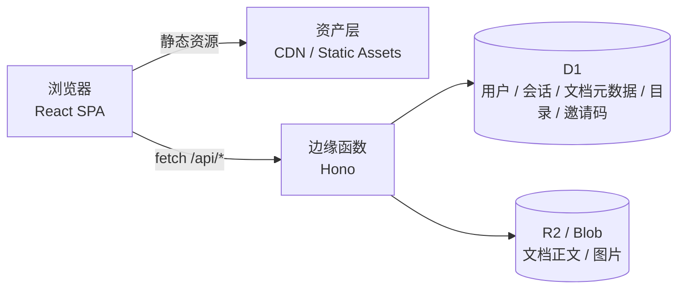

<div align="center">

# OpenDocs

**可自托管的在线文档协作系统**

白板 / 思维导图 · Markdown · Word · Excel · 演示文稿
一套账号、一套目录、一套分享，一次部署。

[](https://docs.opendocs.dev)
[](docs/guide/deploy.md)
[](LICENSE)
[](package.json)

[简体中文](README.md) · [English](README_en.md) · [在线文档](https://docs.opendocs.dev)

</div>

---

## 这是什么

OpenDocs 把「画」和「写」放进同一个工作台：既要能画白板与思维导图，也要能写文档、表格与演示，
同时不想为每种文档维护一套账号与分享体系。

前端是纯静态产物，后端是一个可部署到边缘运行时的 Hono 应用。
数据全部落在自己的 Cloudflare（或 EdgeOne）账号下，不经过任何第三方服务。

> 白板内核来自开源项目 [Drawnix](https://github.com/plait-board/drawnix)（`packages/drawnix`，MIT，声明见 [NOTICE](NOTICE)）。
> OpenDocs 在其之上补齐了账号、云端存储、目录、分享与管理后台。

---

## 功能

| 模块 | 能力 |
| --- | --- |
| **文档类型** | 白板/思维导图、Markdown、Word、Excel、演示文稿、图片编辑 |
| **账号** | 邮箱注册登录、PBKDF2 密码哈希、HttpOnly 会话、邮箱验证、找回密码 |
| **邀请制** | 邀请码可用次数 / 有效期 / 启停，名额扣减并发安全 |
| **文档管理** | 创建、重命名、副本、移动、收藏、搜索、分页、列表/卡片视图、右键菜单 |
| **目录** | 多级文件夹，重命名与删除不丢数据（文档上提到父级） |
| **分享** | 链接分享（只读/可编辑）、按邮箱邀请协作者、我的分享 / 与我共享 |
| **最近删除** | 可配置保留时长（1–365 天），过期自动彻底清理 |
| **免登录** | 首页直接试用编辑器，草稿存本地，登录后一键保存到账号 |
| **管理后台** | 用户、文档、邀请码、站点设置（名称/注册开关/邮件/人机验证） |
| **导出** | `.drawnix`、Markdown、PDF、`.docx`、`.xlsx`、`.pptx`、PNG |

## 技术栈

```
前端    React 19 · Vite · Nx · CSS Modules（无 UI 框架）
后端    Hono · TypeScript
数据    Cloudflare D1（结构化）+ R2 / EdgeOne Blob（正文与图片）
部署    Workers Static Assets / EdgeOne Cloud Functions
文档    VitePress + GitHub Actions
```

## 架构一览



- 静态请求不进入函数：`assets.run_worker_first` 只包含 `/api/*`
- 正文不存数据库：`documents` 只存 `content_key`，规避 D1 单行 1MB 限制
- 业务代码与平台解耦：同一份 `apps/api` 可跑在 Workers、EdgeOne 与本地 Node

详细设计见 [架构文档](docs/architecture.md)。

---

## 快速开始

```bash
# 依赖（Node 20+）
npm install

# 终端 1：本地后端（node:sqlite，:8788）
npm run dev:api

# 终端 2：前端开发服务器（:7200）
npm start
```

打开 `http://localhost:7200`，**第一个注册的账号自动成为管理员**。

```bash
npm run test:api        # 后端端到端冒烟测试（无需云资源）
npm run typecheck:api   # 后端类型检查
```

## 部署

```bash
cp wrangler.jsonc.example wrangler.jsonc   # 填入自己的 database_id

npx wrangler d1 create opendocs
npx wrangler r2 bucket create opendocs-files
npx wrangler d1 execute opendocs --remote --file=./migrations/0001_init.sql
npx wrangler d1 execute opendocs --remote --file=./migrations/0002_folders_invites.sql

npm run deploy:cf
```

- `wrangler.jsonc` 已 gitignore，仓库只提交模板
- EdgeOne 部署见 [部署文档](docs/guide/deploy.md)
- 面向国内用户时请绑定自有域名（`*.workers.dev` 访问不稳定）

## 文档

| 文档 | 内容 |
| --- | --- |
| [功能说明](docs/guide/features.md) | 每类文档与每个模块的能力边界 |
| [使用教程](docs/guide/tutorial.md) | 从注册到分享的完整流程 |
| [部署方式](docs/guide/deploy.md) | Cloudflare / EdgeOne / 文档站自定义域名 |
| [开发方式](docs/guide/development.md) | 目录结构、命令、扩展指南 |
| [架构设计](docs/architecture.md) | 分层、数据模型、鉴权、并发 |
| [设计规范](docs/design.md) | 设计 token、布局、组件、状态 |
| [需求说明](docs/requirements.md) | 角色、需求清单、验收标准 |

```bash
npm run docs:dev      # 本地预览文档站
npm run docs:build    # 产物：docs/.vitepress/dist
```

文档站由 `.github/workflows/docs.yml` 自动构建并发布到 GitHub Pages，
自定义域名通过 `docs/public/CNAME` 固定（默认 `docs.opendocs.dev`）。

## 仓库结构

```
apps/web            React SPA
apps/api            Hono 后端（平台无关）
packages/drawnix    白板内核（上游库）
platform/           Cloudflare / EdgeOne / Node 适配层
migrations/         D1 迁移
docs/               VitePress 文档站
scripts/            启动、构建、冒烟测试
```

## 路线图

- [x] 五类文档 + 账号 + 目录 + 分享 + 管理后台
- [x] 邀请码注册、最近删除保留策略
- [x] 免登录试用与本地草稿保存到账号
- [x] 图片编辑（背景 / 文字 / 形状 / 图片 / 图层 / 模板 / PNG 导出）
- [x] Excel 接入 Univer（公式、数字格式、多工作表）
- [x] Word 接入 Univer Docs（docx 导出支持段落/文字样式/对齐）
- [x] 演示文稿重写为自由画布（拖拽缩放、多选框选、吸附线、撤销重做、放映、pptx 导出）
- [x] 演示文稿元素全量：文字/图片/形状（9 种，含描边与箭头）/表格/图表（8 种）/LaTeX 公式/视频/音频/网页
- [x] 演示文稿备注与页面切换动画
- [x] 演示文稿元素级进入动画（淡入/四向飞入/缩放/擦除，可设时长与延迟）
- [x] 演示文稿母版主题：主题配色、正文字色、底色，可一键应用到全部页面
- [ ] 演示文稿版式模板（标题页/目录页/两栏）与图片裁剪
- [x] 图片编辑器与 PPT 共用素材库（上传一次，两端复用）
- [ ] Word 导出补齐表格与图片（Univer 无官方导出插件，需自研转换）
- [ ] 实时协同（CRDT / Durable Objects）

## 贡献

见 [CONTRIBUTING.md](CONTRIBUTING.md)。提交前请确保：

```bash
npm run typecheck:api
npm run test:api
npm run build:web
```

## 致谢

OpenDocs 站在这些优秀开源项目之上，界面统一为 OpenDocs 品牌，在此致谢：

| 项目 | 在本项目中的角色 | 许可证 | 链接 |
| --- | --- | --- | --- |
| poster-design | 图片编辑器的移植来源（编辑器布局、元素模型、图层与样式面板，以 React 重新实现） | AGPL-3.0 | https://github.com/palxiao/poster-design |
| OpenPPT | 演示文稿编辑器的移植来源（幻灯片模型、工具栏与元素样式面板，以 React 重新实现） | GPL-3.0 | https://github.com/YOOTeam/OpenPPT |
| Drawnix | 白板内核（`packages/drawnix`），无限画布与思维导图 | MIT | https://github.com/plait-board/drawnix |
| Univer | 表格与文档引擎（以 npm 包方式引入） | Apache-2.0 | https://github.com/dream-num/univer |
| PPTist | OpenPPT 的上游，交互与功能参考 | AGPL-3.0 | https://github.com/pipipi-pikachu/PPTist |

> 各项目的版权归原作者所有，完整声明见 [NOTICE](NOTICE)。

## 许可

本项目以 [AGPL-3.0-or-later](LICENSE) 发布。

**这意味着什么**：任何人修改本项目并通过网络向他人提供服务，必须向这些用户公开修改后的完整源码（AGPL-3.0 第 13 条）。
自行部署且不对外提供服务、或不做任何修改的，不受此条约束。

图片编辑器移植自 [poster-design](https://github.com/palxiao/poster-design)（AGPL-3.0），
演示文稿编辑器移植自 [OpenPPT](https://github.com/YOOTeam/OpenPPT)（GPL-3.0），
因此整体采用 AGPL-3.0。各上游项目的版权与许可证见 [NOTICE](NOTICE)。
