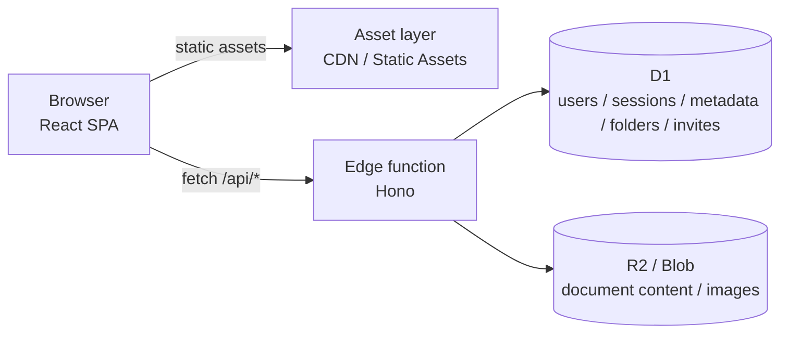

<div align="center">

# OpenDocs

**A self-hostable online document suite**

Whiteboard / mind map · Markdown · Word · Excel · Presentations
One account, one folder tree, one sharing model — deploy once.

[](https://docs.opendocs.dev)
[](docs/guide/deploy.md)
[](LICENSE)
[](package.json)

[简体中文](README.md) · [English](README_en.md) · [Documentation](https://docs.opendocs.dev)

</div>

---

## What it is

OpenDocs puts drawing and writing in one workspace: whiteboards and mind maps next to documents,
spreadsheets and slide decks — without maintaining a separate account and sharing model for each.

The frontend is a static SPA. The backend is a Hono app that runs on edge runtimes.
All data lives in your own Cloudflare (or EdgeOne) account; nothing goes through a third party.

> The whiteboard is built on the open-source [Drawnix](https://github.com/plait-board/drawnix) core
> (`packages/drawnix`, MIT). OpenDocs adds accounts, cloud storage, folders, sharing and an admin console.

---

## Features

| Area | Capability |
| --- | --- |
| **Document types** | Whiteboard / mind map, Markdown, Word, Excel, Presentations, Image editor |
| **Accounts** | Email sign-up/sign-in, PBKDF2 hashing, HttpOnly sessions, email verification, password reset |
| **Invite-only** | Usage limit, expiry, enable/disable, concurrency-safe redemption |
| **Documents** | Create, rename, duplicate, move, star, search, pagination, list/card views, context menu |
| **Folders** | Multi-level tree; deleting a folder re-parents documents instead of losing them |
| **Sharing** | Link sharing (view/edit), invite collaborators by email, "Shared by me" / "Shared with me" |
| **Trash** | Configurable retention (1–365 days), auto-purged after expiry |
| **Guest mode** | Try any editor without signing in; drafts stay local and can be saved to an account |
| **Admin** | Users, documents, invite codes, site settings (name, registration, mail, captcha) |
| **Export** | `.drawnix`, Markdown, PDF, `.docx`, `.xlsx`, `.pptx`, PNG |

## Stack

```
Frontend  React 19 · Vite · Nx · CSS Modules (no UI framework)
Backend   Hono · TypeScript
Data      Cloudflare D1 (metadata) + R2 / EdgeOne Blob (content & images)
Deploy    Workers Static Assets / EdgeOne Cloud Functions
Docs      VitePress + GitHub Actions
```

## Architecture



- Static requests never enter the function: `run_worker_first` only covers `/api/*`
- Content is not stored in the database: `documents` keeps `content_key`, avoiding D1's 1 MB row limit
- Business code is platform-agnostic: the same `apps/api` runs on Workers, EdgeOne and local Node

See [architecture](docs/architecture.md) for details.

---

## Quick start

```bash
npm install

npm run dev:api     # backend on :8788 (node:sqlite)
npm start           # frontend on :7200
```

Open `http://localhost:7200`. **The first registered account becomes the administrator.**

```bash
npm run test:api        # end-to-end smoke tests (no cloud resources needed)
npm run typecheck:api
```

## Deploy

```bash
cp wrangler.jsonc.example wrangler.jsonc   # fill in your database_id

npx wrangler d1 create opendocs
npx wrangler r2 bucket create opendocs-files
npx wrangler d1 execute opendocs --remote --file=./migrations/0001_init.sql
npx wrangler d1 execute opendocs --remote --file=./migrations/0002_folders_invites.sql

npm run deploy:cf
```

`wrangler.jsonc` is gitignored; only the template is committed.
For EdgeOne, see the [deployment guide](docs/guide/deploy.md).

## Documentation

The full guides are written in Chinese and published with VitePress:

```bash
npm run docs:dev      # local preview
npm run docs:build    # output: docs/.vitepress/dist
```

Docs are built and published by `.github/workflows/docs.yml` (GitHub Pages),
with a custom domain pinned via `docs/public/CNAME` (default `docs.opendocs.dev`).

## Repository layout

```
apps/web           React SPA
apps/api           Hono backend (platform-agnostic)
packages/drawnix   whiteboard core (upstream)
platform/          Cloudflare / EdgeOne / Node adapters
migrations/        D1 migrations
docs/              VitePress documentation site
scripts/           dev, build, smoke tests
```

## Roadmap

- [x] Five document types, accounts, folders, sharing, admin console
- [x] Invite-only registration, trash retention policy
- [x] Guest mode with local drafts saved to an account
- [x] Image editor (background, text, shapes, images, layers, PNG export)
- [ ] Image editor: asset library and templates
- [ ] Full Word / Excel editing via Univer
- [ ] Presentation free-form canvas and slideshow
- [ ] Real-time collaboration (CRDT / Durable Objects)

## License

[MIT](LICENSE). The Drawnix whiteboard core is MIT-licensed, copyright its original authors.
